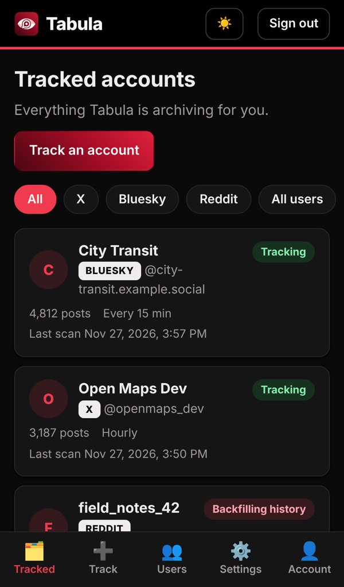
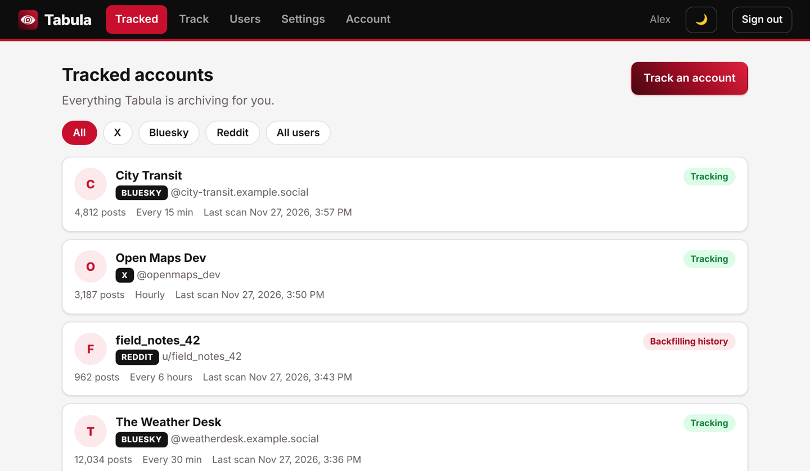

<p align="center">
  
</p>

<h1 align="center">Tabula</h1>

<p align="center">
  <strong>Keep tabs on the social media accounts you care about.</strong><br>
  Self-hosted, open source, and yours.
</p>

<p align="center">
  <a href="https://github.com/zollo/tabula/actions/workflows/ci.yml"></a>
  <a href="https://github.com/zollo/tabula/releases"></a>
</p>

---

Tabula archives social media accounts for you. Pick accounts on **X, Bluesky
and Reddit**, choose how often to check them, and Tabula pulls in their
history, keeps scanning for new posts, and gives you one searchable archive you
can browse on your phone or export as **JSON** or **PDF**. You run it yourself,
so the archive stays on your server even if the posts disappear from the
platform.

<p align="center">
  
</p>

## Features

**Track any public account**
- Paste a handle or profile URL for X, Bluesky or Reddit and pick a scan
  frequency, from every 15 minutes to weekly. Pause, change or stop tracking
  any time; stopping keeps the archive.
- Tabula **backfills history** in the background as soon as you add an account
  (resumable, capped by an admin setting), then checks for new posts on your
  schedule. **Scan now** is one tap away.
- Accounts are shared: if two people track the same account there is one
  archive, scanned at the shorter of their intervals.

**Browse, search and export**
- Every post, reply, repost, quote and Reddit comment with its text, time,
  link, media and engagement numbers, plus the platform's raw payload.
- Search and filter by text, kind and date range, then download exactly what
  you see as JSON or a readable PDF.

**Three ways to collect**
- **APIs** where you have credentials (Bluesky needs none).
- A **headless browser** for X and Reddit, using a login you save once, paced
  and capped per login. On X it reaches further back than the API's 3,200 posts.
- **Public pages** for Reddit: no app, token, account or browser at all.

**People and permissions**
- Users see only the accounts they track; admins see everything and manage
  users and system settings from the app.
- Sign up with a password or **Google**. New sign-ups can browse but can't
  track anyone until an admin enables them.
- Platform credentials can be saved in the app, encrypted, and are never shown
  again.

**Built for phones**
- A mobile-first UI with a bottom tab bar, big touch targets, and light and
  dark themes in red and black.

<p align="center">
  
</p>

## Platforms

| Platform | How | Credentials | History reach |
|---|---|---|---|
| **Bluesky** | Public AppView (`app.bsky.feed.getAuthorFeed`) | None | Full history |
| **Reddit** | OAuth API (`/user/{name}/overview`), a browser, or [public pages](#reddit-without-a-login) | A "script" app from [reddit.com/prefs/apps](https://www.reddit.com/prefs/apps) (`REDDIT_CLIENT_ID` / `_SECRET`); none for public pages | About 1,000 most recent items (Reddit's listing limit) |
| **X** | API v2 (`/2/users/{id}/tweets`) or a [browser](#browser-collection) | App bearer token `X_BEARER_TOKEN` (needs a **paid X API tier**), or a saved login | 3,200 most recent posts via the API; further back via the browser |

Credentials come from environment variables or are saved by an admin under
**Settings → Platform connections**, where they're stored encrypted (with a key
derived from `SECRET_KEY`). A saved value overrides the environment one.

## Self-hosting

Tabula is a FastAPI backend, a Celery scheduler and workers, a React app served
by nginx, Postgres, and Redis (as the job queue only; nothing durable lives
there). Images are published to GHCR as `ghcr.io/zollo/tabula-backend`,
`ghcr.io/zollo/tabula-browser` and `ghcr.io/zollo/tabula-frontend` for every
release.

```
          ┌──────────── browser (React SPA) ───────────┐
          │  nginx (frontend image)                     │
          │   /           → SPA                         │
          │   /api, /docs, /openapi.json ──┐            │
          └────────────────────────────────┼────────────┘
                                           ▼
                            FastAPI (backend image) ──► Postgres
                                  │ queue                ▲  (users, settings,
                                  ▼                      │   accounts, posts)
       Celery beat ──► Redis ──┬──► worker ──────────────┤──► X / Bluesky / Reddit APIs
                               └──► browser worker ──────┘──► x.com / reddit.com (Chromium)
```

Run exactly one **beat** (the scheduler). The backend, **worker** (`default`
queue) and **browser worker** (`browser` queue) all scale horizontally.

### Docker Compose

Configure first, then start. Postgres takes its password from `.env` on the
very first start only, so set it before you bring the stack up.

```bash
git clone https://github.com/zollo/tabula.git && cd tabula
cp .env.example .env        # then edit .env (see the table below)
docker compose -f docker-compose.yml up -d --build
```

Open http://localhost:8080 and sign in as the bootstrap admin from `.env`
(with no password set, a random one is printed in the backend log on first
start). Bluesky works with no setup; add X or Reddit credentials under
**Settings**.

Pass `-f docker-compose.yml` for a real deployment: plain `docker compose up`
(and `make up`) also loads `docker-compose.override.yml`, a development setup
with hot reload.

Settings to review in `.env`:

| Setting | What it does |
|---|---|
| `SECRET_KEY` | Signs sessions and encrypts saved credentials. Use a long random string (`openssl rand -hex 32`); with `TABULA_ENV=production` a placeholder is refused. Changing it makes saved platform credentials unreadable. |
| `POSTGRES_PASSWORD` | Database password. Set it before the first start; changing it later doesn't change the existing database's password. |
| `TABULA_PUBLIC_URL` | The address people use, e.g. `https://tabula.example.com` (used for Google sign-in). |
| `BOOTSTRAP_ADMIN_EMAIL`, `BOOTSTRAP_ADMIN_PASSWORD` | The first admin, created on startup if missing. |
| `ALLOW_REGISTRATION` | Initial value of the sign-up switch (admins change it in the app later). |
| `X_BEARER_TOKEN`, `REDDIT_CLIENT_ID`, `REDDIT_CLIENT_SECRET`, `REDDIT_USER_AGENT` | Platform API credentials (or save them in the app). |
| `GOOGLE_CLIENT_ID`, `GOOGLE_CLIENT_SECRET` | Turn on Google sign-in (see below). |
| `SCHEDULER_TICK_SECONDS`, `BACKFILL_PAGES_PER_RUN` | How often the scheduler looks for due work, and how many history pages each backfill task fetches. |
| `BROWSER_WORKER_CONCURRENCY` | Browser tasks per browser-worker process. |

Every option is documented in [`.env.example`](.env.example). Most day-to-day
settings (sign-up, platforms, scan limits, backfill cap, credentials) are edited
by admins in the app. The frontend proxies `/api` to the backend, so only one
port needs to be published; put your own HTTPS reverse proxy in front of it.

### TrueNAS SCALE

[`deploy/truenas/`](deploy/truenas/) has a compose file that uses the prebuilt
images, publishes a single port (30082), and keeps Postgres on a dataset you
can snapshot. See its [README](deploy/truenas/README.md).

### Kubernetes (Helm)

The chart needs `SECRET_KEY` and `POSTGRES_PASSWORD`, either from a Secret you
create or from `secrets` in your values:

```bash
kubectl create secret generic tabula-secrets \
  --from-literal=SECRET_KEY="$(openssl rand -hex 32)" \
  --from-literal=POSTGRES_PASSWORD="$(openssl rand -hex 16)" \
  --from-literal=BOOTSTRAP_ADMIN_PASSWORD="$(openssl rand -hex 12)"

helm install tabula oci://ghcr.io/zollo/charts/tabula --version <release> \
  --set existingSecret=tabula-secrets \
  --set ingress.enabled=true --set ingress.hosts[0]=tabula.example.com \
  --set config.TABULA_PUBLIC_URL=https://tabula.example.com
```

The chart runs database migrations on start and scales the backend and workers
horizontally (`worker.replicas`, `browserWorker.replicas`, or KEDA on the
`browser` queue with `browserWorker.keda`); beat stays at one replica. Its
Ingress sends `/api`, `/docs`, `/redoc` and `/openapi.json` to the backend. See
[`charts/tabula/values.yaml`](charts/tabula/values.yaml) for external Postgres,
resources, and `postgresql.backup` (a nightly `pg_dump` CronJob).

Images are signed with cosign (keyless) and carry build-provenance
attestations:

```bash
IMAGE=ghcr.io/zollo/tabula-backend:latest
cosign verify "$IMAGE" \
  --certificate-identity-regexp "https://github.com/zollo/tabula/.github/workflows/ci.yml@.*" \
  --certificate-oidc-issuer https://token.actions.githubusercontent.com
gh attestation verify "oci://$IMAGE" --repo zollo/tabula
```

### Browser collection

X and Reddit can be collected with a headless browser instead of their APIs
(**Settings → Collection sources**, per platform). On X this needs no paid API
and reaches further back: it walks a "Latest" search for `from:<handle>` with a
`max_id` cursor instead of the profile timeline's ~3,200-post limit. On Reddit
it reaches the same ~1,000 items as the API.

- **Saved logins.** Run `python backend/app/tools/capture_session.py x
  x-session.json` on your own computer (needs `pip install playwright` and
  `playwright install chromium`), sign in, and upload the file under Settings.
  X needs a signed-in login; Reddit also works signed out. Logins are stored
  encrypted and never returned by the API.
- **Pacing.** Each browser task leases one login (never shared by two
  browsers), waits *Seconds between pages* between page loads, and stops at
  *Pages per login per day*. A rate limit cools the login down for 15 minutes;
  a login wall or challenge parks it as *Needs a new login*. Tabula doesn't try
  to get around either.
- **Scaling.** Throughput ≈ logins × pages per login. Add logins, then add
  browser-worker processes to match.
- **Fragility and terms.** It reads the JSON the sites' own web apps load,
  which changes without notice: when it does, scans report "didn't return any
  data" until the parser is updated. Automated access is against X's and
  Reddit's terms, and accounts used this way may be locked or suspended.

### Reddit without a login

Pick **Public pages (no login)** for Reddit under **Settings → Collection
sources** to collect posts and comments with no API app, token, account or
browser. The regular worker reads the public `.json` views reddit.com serves
signed-out visitors (100 items a page) and reaches the same ~1,000 most recent
items.

- **Pacing.** Reddit allows about 10 unauthenticated requests a minute per IP,
  so every worker shares one pace through the database (*Seconds between public
  requests*, default 10, minimum 6). When the queue of slots is more than a
  minute long, scans and backfills step aside and the scheduler picks them up
  again when their slot comes round.
- **Backing off.** Tabula honours Reddit's `x-ratelimit-*` headers and `429`s by
  pausing every worker until the window resets, and an HTML `403` ("blocked")
  pauses public requests for 15 minutes. Reddit blocks many datacenter IPs
  outright; a home connection usually works.
- **User agent.** Requests send `REDDIT_USER_AGENT` (or the saved value); keep
  it descriptive, since Reddit throttles generic agents hardest.

### Google sign-in

Set `GOOGLE_CLIENT_ID` and `GOOGLE_CLIENT_SECRET` and the sign-in and sign-up
pages show **Sign in with Google**; every user can link or unlink Google from
the Account page.

- A **linked** Google account signs straight into its Tabula account.
- An unlinked Google account with a **new** email creates a user (if sign-up is
  on and Google verified the email). Like any sign-up, it can't track anyone
  until an admin enables it.
- If the email **already belongs** to a Tabula account, sign-in is refused: the
  owner signs in with their password once and links Google. Tabula never merges
  accounts by email alone.

To create the OAuth client, in the [Google Cloud
console](https://console.cloud.google.com/) set up **Google Auth Platform →
Branding** (app name, support email, your domain under *Authorized domains*)
and **Audience** (*External*, then **Publish app**; Tabula only asks for
`openid`, `email` and `profile`, which need no verification). Then **Clients →
Create client → Web application** with your public URL as an *Authorized
JavaScript origin* and `<TABULA_PUBLIC_URL>/auth/google/callback` as the
*Authorized redirect URI*, exactly. Google only accepts `https://` redirects on
a public domain (plus `http://localhost`), so a LAN address like
`http://truenas.local:30082` won't work.

### Admins

The first admin comes from `BOOTSTRAP_ADMIN_*`. Admins manage everyone else
under **Users** (create accounts, enable sign-ups, change roles, deactivate,
set passwords) and the system under **Settings** (sign-up on/off, platforms,
collection sources, scan limits, backfill cap, credentials, saved browser
logins). The last active admin can't be demoted, deactivated or deleted.

## API

Everything the web app does goes through a REST API under `/api`. Interactive
docs are served at `/docs`, and the OpenAPI spec is in
[`docs/openapi.json`](docs/openapi.json) and attached to each release.
Authenticate with `Authorization: Bearer <token>` from `POST /api/auth/login`.

| Operation | Purpose |
|---|---|
| `GET /api/options` | Platforms you can track and the scan-interval limits |
| `GET/POST /api/trackings` | Your tracked accounts / track a new one (`platform`, `handle` or profile URL, `scan_interval_minutes`) |
| `PATCH/DELETE /api/trackings/{id}` | Change frequency, pause, or stop tracking (the archive is kept) |
| `POST /api/trackings/{id}/scan` | Scan now |
| `GET /api/accounts/{id}/posts` | Browse: `q`, `kind`, `since`, `until`, `limit`, `offset` |
| `GET /api/accounts/{id}/export?format=json\|pdf` | Download the archive (same filters) |
| `GET/PATCH /api/settings` | System settings (admin) |
| `GET/POST/PATCH/DELETE /api/users` | User management (admin) |

## Development

```bash
cd backend && pip install ".[dev]" && ruff check . && pytest -q
cd frontend && npm install && npm run build && npm test
```

Tests run on SQLite with no Redis, browser or network (platforms are faked).
The app icons are drawn by [`scripts/make_icons.py`](scripts/make_icons.py)
(`pip install pillow`, then run it to regenerate every size).

See [CLAUDE.md](CLAUDE.md) for commands and architecture notes, and
[CONTRIBUTING.md](CONTRIBUTING.md) for branching and PR-title rules (squash
merges, Conventional Commits drive the release version). Longer design notes,
the data model and the roadmap live in
[Notion](https://app.notion.com/p/4211d6dd324881a19677e349d64a738a).

**Stack:** FastAPI · SQLAlchemy 2 (async) · Alembic · Celery · Redis · Postgres ·
Playwright · React + Vite + TypeScript · nginx · Docker Compose · Helm
